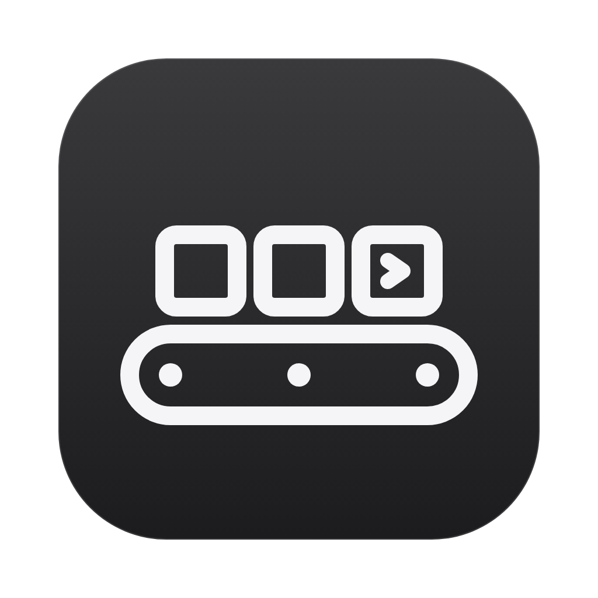
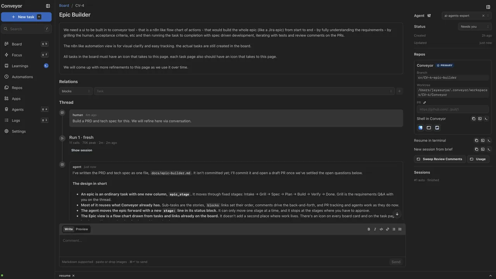
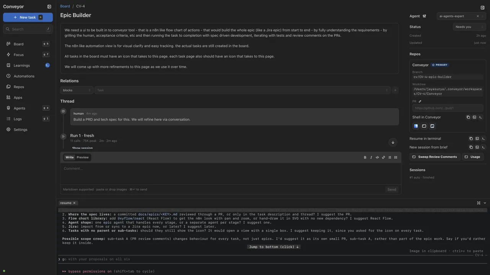
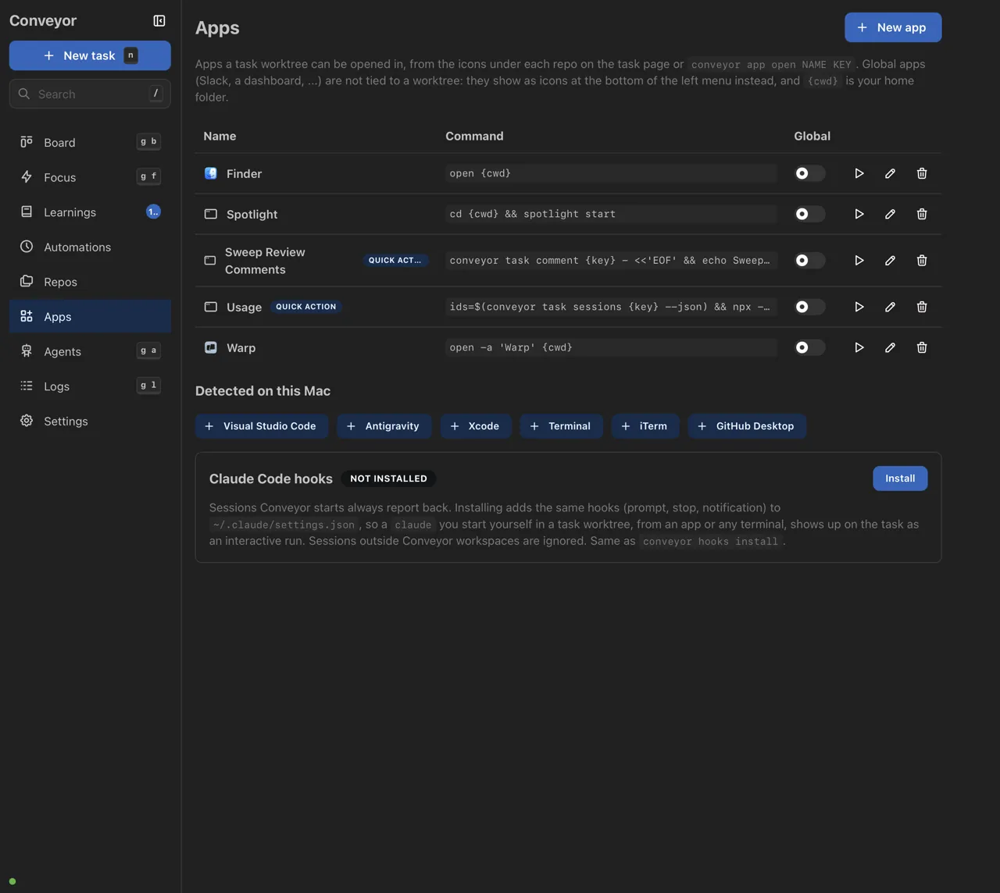
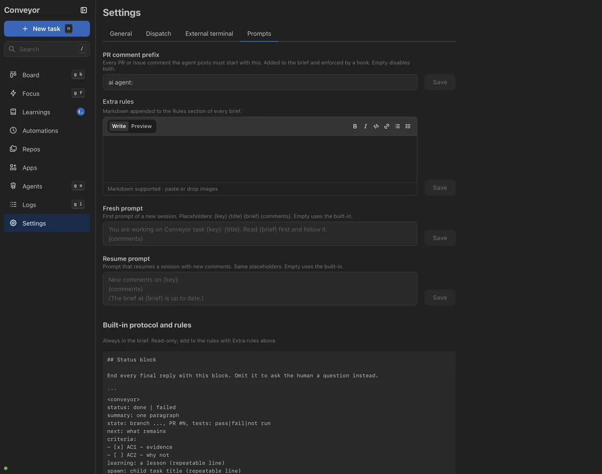
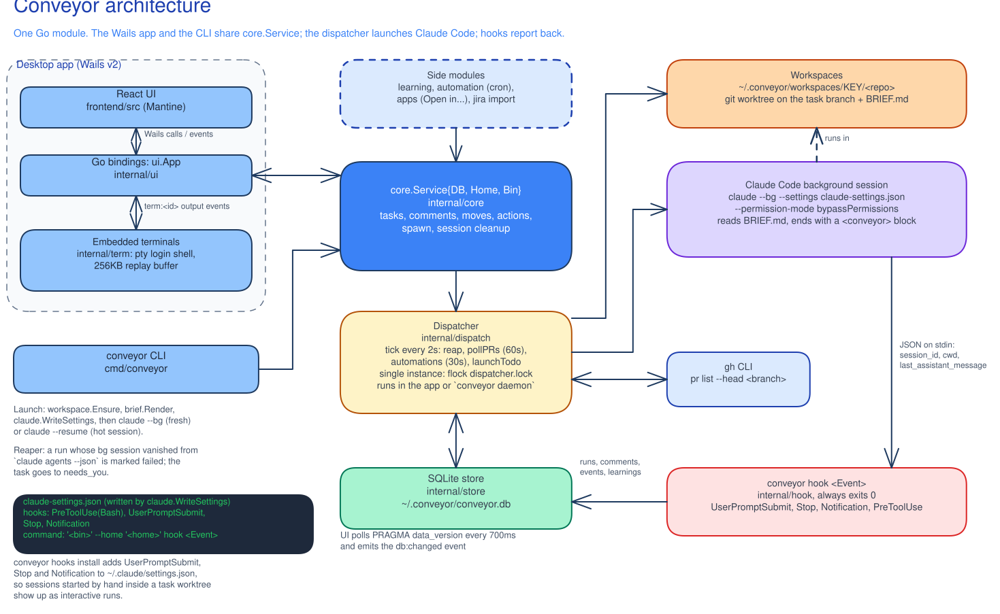

<p align="center">
  
</p>

<h1 align="center">Conveyor</h1>

<p align="center">
  <b>A local kanban that orchestrates agentic tasks.</b>
</p>

<!-- Screenshots: drop PNGs in docs/screenshots/ (board.png, task-page.png) -->

<table>
  <tr>
    <td width="50%"></td>
    <td width="50%"></td>
  </tr>
  <tr>
    <td width="50%" align="center"></td>
    <td width="50%" align="center"></td>
  </tr>
</table>

---

## What it is

Conveyor is a local kanban that runs tasks through Claude Code background sessions. Each task has a Jira-like page with a comment thread; a comment triggers the next run; every run is a real Claude session you can attach to; each task works in its own workspace folder holding one git worktree per repo. It tries to stay simple, predictable and intuitive.

- **Your repo's setup is used as is.** Runs load the repo's own `CLAUDE.md`, skills, commands and agents.
- **You can step in at any time.** Attach to a running session, resume it in your terminal, or open a fresh one with the task's context.
- **Comments move the work forward.** Comment on a finished task and the next run picks it up. Comments sent during a run are queued for the next one.
- **Tasks close themselves.** Conveyor follows each PR with `gh` and marks the task done when it merges.
- **Runs stay lean.** Each run starts with only the context it needs, and Conveyor learns from past runs (see below).

## How it works



**One task, one workspace.** Each task gets `~/.conveyor/workspaces/<KEY>/` with one git worktree per repo and a short `BRIEF.md`. For multi-repo tasks, the primary repo is the working directory, the others are added with `--add-dir`, and each repo gets at most one PR.

**The app and the CLI do the same things.** Both call the same `core.Service`, so anything you can click, you or an agent can also script. Agents use the CLI to split work into sub-tasks and links.

**Status comes from Claude Code's hooks.** The hooks call `conveyor hook`. When an agent stops, its status block moves the task to Review or Needs you.

**The worktree is the boundary.** Unattended runs skip permission prompts but work only in the task's worktree. Interactive sessions keep the normal permission prompts.

## Keeping runs lean

Most of a run's cost is the context it starts with, so Conveyor chooses that context for each run.

**Resume or start fresh.** If the last session ended under `resume_threshold` (60K tokens), the next comment resumes it and sends only the new comments. Above that, a fresh session starts from the brief, which is roughly 15–20K tokens instead of 78–150K.

**A short brief.** `BRIEF.md` is a few KB: the description, the acceptance criteria and their state, the last run's next step, one-line summaries of past runs, and your comments. The full thread is one command away.

**A clear hand-off.** Every run ends with a `status / summary / state / next / criteria / learning / spawn` block, which feeds the next brief.

**Context isn't loaded twice.** Claude Code already loads the primary repo's skills, so the brief lists only the other repos' context. Runs use `--strict-mcp-config` with the repo's `.mcp.json`, so other MCP servers stay out of the prompt.

**Usage is recorded.** Every run records API calls, peak context and token counts, so you can tune settings from real numbers.

## Getting better over time

- **Learnings.** Agents report `learning:` lines. Accepted ones are kept in Conveyor's data folder and loaded into every task on that repo; the few the team should share can go to the repo's `CLAUDE.md` through a PR.
- **Conveyor doctor.** Every Monday a task reviews the week's longest, shortest, failed and most-commented runs and suggests prompt and settings fixes.
- **Automations.** Scheduled tasks, such as sweeping PR review comments, show up as cards on the board.

More: [the showcase page](docs/showcase.md) (decisions and trade-offs) and the [user guide](docs/guide.md) (task states, hook flow, every feature).

---

## Quick start

Requires Go 1.25, `git`, the `claude` CLI, and `gh` for PR tracking.

```sh
scripts/install.sh                       # CLI → ~/.local/bin, Conveyor.app → /Applications
claude                                   # once per repo: accept the trust prompt, then exit
conveyor repo add ~/work/my-repo
conveyor task new "Fix the thing" --repo my-repo --desc "..." --todo
conveyor daemon                          # or just open the app
conveyor task comment CV-1 "also do X"   # send it back for another pass
conveyor state export ~/cv.json          # settings/apps/automations/agents as JSON, no repos; `state import` on a fresh install
conveyor --home /tmp/mock mock seed      # empty home -> mock repos, one task per board scenario, plus settings/apps/automations (all in internal/core/mock.go)
```

`claude --bg` refuses untrusted folders, so do the trust step once per repo. A "workspace not trusted" launch failure means it was skipped. `CONVEYOR_HOME` (default `~/.conveyor`) holds the DB, logs and workspaces.

## For AI agents

Start with [`.claude/skills/conveyor/SKILL.md`](.claude/skills/conveyor/SKILL.md): commands, file locations, code map, troubleshooting.

| Need | Where |
|---|---|
| How to use every feature | [`docs/guide.md`](docs/guide.md) |
| Design and data model | [`docs/tech-spec.md`](docs/tech-spec.md) |
| Verified Claude Code `--bg` behaviour | [`docs/research/spike-bg.md`](docs/research/spike-bg.md) |
| Decisions and token strategy | [`docs/showcase.md`](docs/showcase.md) |
| Diagrams (sources are `.excalidraw`) | [`docs/diagrams/`](docs/diagrams/) |

**Tech:** Go, SQLite (`internal/store`), Wails + React/Mantine (`frontend/`, bindings in `internal/ui`), core logic in `internal/core`, CLI in `cmd/conveyor`, embedded terminals in `internal/term`. One dispatcher at a time (lock file in `CONVEYOR_HOME`), in the app or `conveyor daemon`, ticking every 2 seconds.

**CLI:** `conveyor <command>` with no args prints usage; list/show commands take `--json`.

```
agent  app  automation  config  daemon  hook  hooks  import  learning  repo  task
```

Integrations (terminal templates, external apps, global hooks, automations, Jira import) are covered in the [guide](docs/guide.md).

**Checks:** `gofmt -l .`, `go vet ./...`, `go test ./...`; frontend: `cd frontend && npm ci && npm run build`. End-to-end: `scripts/e2e.sh` against real `claude` (haiku) on two pre-trusted throwaway repos in `~/work/conveyor-e2e/` (override with `E2E_ROOT`).

## Roadmap

- A wrapped UI component layer so Mantine can be swapped in one place.
- A remote backend: dispatcher, DB and workspaces on a server, driven over an API.
- A ⌘K command palette for tasks, views and actions.
