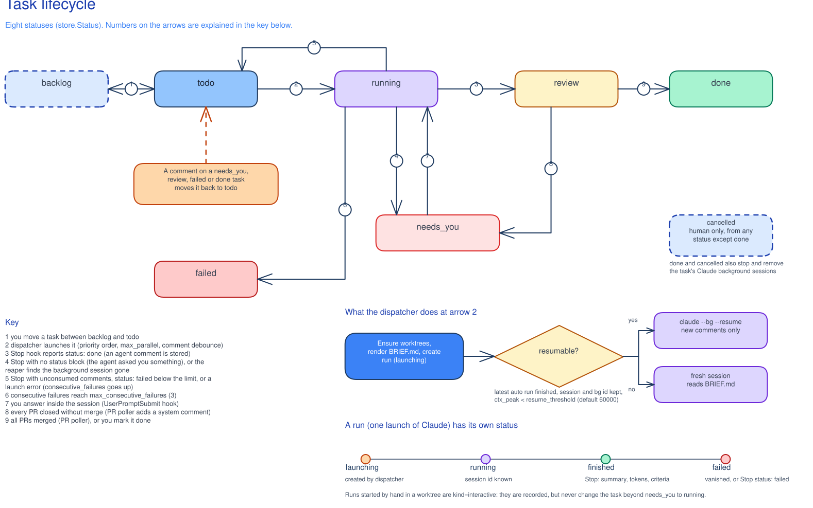
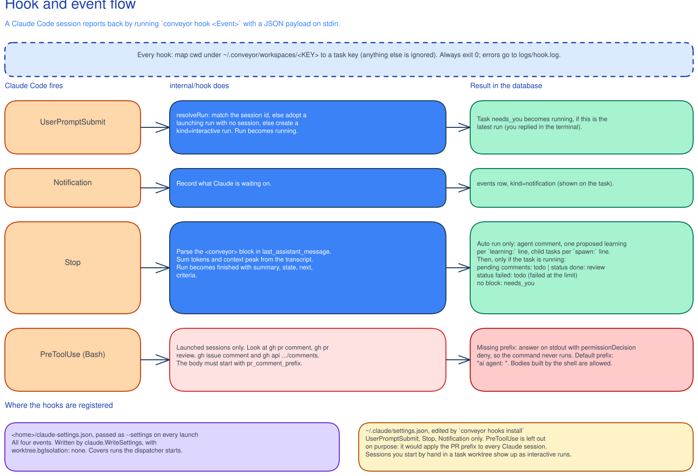

# Conveyor user guide

Conveyor is a local kanban board. You describe a task, Conveyor starts a Claude Code session for it in its own git worktree, and the session reports back when it stops. You review the result, comment to send it back, or mark it done.

This guide covers day-to-day use. For setup see the [README](../README.md); for the design see [tech-spec.md](tech-spec.md). Where the two disagree with the code, the code is right.

## Concepts

- **Task.** A card with a key (`CV-12`, the prefix is the `key_prefix` setting), a title, a description, one or more repos, a status, a priority, an optional model and agent, and a comment thread.
- **Run.** One launch of Claude for a task. A run has its own status (`launching`, `running`, `finished`, `failed`), a Claude session id, token counts, and the summary the agent wrote. A task usually has several runs. Runs started by the dispatcher are `auto`; sessions you start yourself in a task worktree are `interactive`.
- **Workspace and worktree.** Each task gets a folder `~/.conveyor/workspaces/<KEY>/` with one git worktree per repo, `<KEY>/<repo>`, on a branch named after the task title. The folder also holds `BRIEF.md`, which the agent reads first. A worktree branches from `origin/<default branch>` after a fetch, or reuses the branch if it already exists. A repo's **setup script** (Settings → Repos, or `conveyor repo setup <name> [script|-]`) runs with bash in each new worktree before the agent starts: stdin closed, 10 minute limit, output in `<KEY>/setup-<repo>.log`, `CONVEYOR_REPO`/`CONVEYOR_REPO_PATH` set. Use it to warm per-worktree caches, e.g. `direnv allow . && direnv exec . true </dev/null` so a nix-direnv dev shell is built before the agent needs it. A failing script fails the launch (the error carries the log tail) and runs again on the next launch.
- **Agent.** Optional. A named Claude Code agent (a prompt, optionally limited to one repo) that a task can run as. Its `model:` frontmatter line is the agent's default model: a task's own model wins, then the agent's, then `default_model`. `conveyor agent list|add|model`, or the Agents page.
- **Models.** The model pickers list the Anthropic Models API result when `ANTHROPIC_API_KEY` is set (`ANTHROPIC_BASE_URL` honoured), else a built-in list (`builtinModels` in `internal/core/models.go`; refresh it when models ship). A tier alias (`opus`, `sonnet`, `haiku`, `fable`) resolves to the newest id of that tier; `conveyor models` shows the list. Model names are not validated when set. If one is wrong, the Claude session fails at startup and the dispatcher moves the task to `needs_you` with a comment saying so (fix the model on the task, its agent or `default_model`, then comment to retry). A blank model means the default: the agent's, else `default_model`, else Claude Code's. `agent list` shows what an alias resolves to and `(default: X)` for a blank.
- **Learning.** A lesson an agent proposes at the end of a run. You accept or reject it; accepted ones go to Conveyor's own `repos/<repo>/LEARNINGS.md`, which every task on that repo loads, or, if you choose, into the repo's `CLAUDE.md` by a follow-up task.
- **Automation.** A cron schedule with an optional shell check that creates a task, comments on tasks, or runs a CLI command.
- **App.** A named shell command that opens a task worktree in an editor, terminal or other program.

## The board and the task page

The sidebar has Board, Focus, Learnings, Automations, Apps, Agents, Logs and Settings (repos are a Settings tab). Board, Focus, Agents and Logs have the shortcuts `b`, `f`, `a` and `l`.

The board has a column per status: Backlog, Todo, Running, Needs you, Review, Failed (only shown when something has failed), Done and Cancelled. Done and Cancelled are collapsed and show the last 7 days. Focus is a single list of what wants your attention, in this order: needs_you, review, failed, running, todo.

The task page shows the description, the comment thread (yours, the agent's final replies, and system notes), the runs with their summaries and acceptance criteria, PR links per repo, and buttons to open a terminal, an editor or an app. Comments can include pasted images; they are saved under `~/.conveyor/workspaces/<KEY>/attachments`. In the comment and description editors, `@` autocompletes files tracked in the task's repos (its worktrees once created; files of non-primary repos as `../<repo>/path`) and `/` autocompletes skills and commands from the repos' and your `~/.claude/skills` and `~/.claude/commands`; rendered markdown colors `@file` and `/command` tokens. Suggestions are queried as you type (files are read from `git ls-files` each time, nothing is cached). On a task page, click an `@file` mention to open it in one of your configured editor apps or reveal it in Finder.

### Statuses



The diagram does not yet show reviving a cancelled task (cancelled -> backlog / todo); `internal/store/status.go` is the source of truth.

- **backlog**: parked. Nothing runs. The description can be edited only here (pencil on the task page, or `conveyor task set KEY --desc ...`); after that, changes go in comments.
- **todo**: waiting for the dispatcher.
- **running**: a session is working on it.
- **needs_you**: the agent stopped without a final status block (it asked you something), or its session disappeared.
- **review**: the agent said it is done. If there is a PR, Conveyor watches it.
- **failed**: repeated failures. Comment to retry.
- **done**: finished, either by you or because every PR merged.
- **cancelled**: only you can cancel, from any status except done. You can revive a cancelled task by moving it back to backlog or todo.

Moving a task to done or cancelled also stops and removes its Claude background sessions. Its workspace (worktrees, `BRIEF.md`, attachments) is kept, so a revived task picks up where it left off; its next run starts a fresh session with a re-rendered brief.

## How dispatch works

One dispatcher runs per Conveyor home. It is part of the app, and `conveyor daemon` runs it in the foreground when the app is closed. A lock file (`dispatcher.lock`) keeps it to one; the app tries to take over every 10 seconds, so closing the daemon hands over to a running app.

Every 2 seconds the dispatcher:

1. Reaps runs. If a run's background session is gone from `claude agents`, after a 30 second grace, the run is marked failed ("session vanished") and the task goes to needs_you.
2. Every 60 seconds, checks PRs of tasks in review with `gh` (see below).
3. Every 30 seconds, runs due automations.
4. Launches `todo` tasks, highest priority first, up to `max_parallel` (default 3) at once. A task with new comments waits `comment_debounce_secs` (default 20) after the last one, so you can write several comments before it starts.

To launch, it creates the worktrees, writes `claude-settings.json` and `BRIEF.md`, creates a run, marks the comments as consumed, moves the task to running and starts Claude:

```
claude --bg <prompt> --name <KEY> --settings <home>/claude-settings.json \
  --permission-mode bypassPermissions --strict-mcp-config [--model m] [--agent a] [--add-dir other-repos]
```

If the launch itself fails, the failure counter goes up and the task returns to todo. After `max_consecutive_failures` (default 3) in a row the task becomes failed with a system comment. Conveyor needs the repo to be trusted by Claude; the comment says so when that is the cause.

The agent works in the worktree and ends its last message with a status block:

```
<conveyor>
status: done | failed
summary: one paragraph
state: branch ..., PR #N, tests: pass|fail|not run
next: what remains
criteria:
- [x] AC1 - evidence
learning: a non-obvious fact about this repo that would save a future task real time; ...
spawn: title of a follow-up task | its description
</conveyor>
```

Each `spawn:` line becomes a backlog sub-task with the parent's repos and the text after `|` as its description. A line without a description creates nothing and records a `spawn_failed` event, so no sub-task starts without context; `conveyor task new --parent` likewise requires `--desc`.

Without a block the agent is treated as asking you a question. `BRIEF.md` explains this protocol to the agent, along with the task, repos, latest runs and your comments. The `brief_extra_rules` setting adds your own rules to it.

**Repo context comes first.** The session's working directory is the primary repo's worktree, a normal checkout of that repo, so Claude Code loads its `CLAUDE.md` and `.claude` skills, commands, agents and settings as usual. The brief tells the agent these are the authority on how to work in the repo, over its own defaults and generic user-level skills; only the worktree, PR and status block rules are Conveyor's. The task's other repos are attached with `--add-dir`, which does not load their `CLAUDE.md`, commands or agents, so the brief lists them (paths and one-liners) under "Other repos' context" for the agent to read when it works there. Gitignored files (`CLAUDE.local.md`, `.claude/settings.local.json`) are not in a worktree.

PR comments: the agent is told to start every PR or issue comment with `pr_comment_prefix` (default `ai agent: `), and a hook blocks `gh` comment commands that lack it.

## Task relations

Tasks can be related, as in Jira. Conveyor only stores the relations; an agent (for example an "engineering manager" that writes a spec and splits it) creates the tasks and hands work off itself, using the CLI that `BRIEF.md` describes.

- **Parent and sub-tasks**: `conveyor task new "..." --parent CV-1`. Without `--repo` a sub-task uses its parent's repos and primary repo, and without `--agent` its parent's agent; pass them to use different ones. In the New task dialog, pick a Parent: it prefills the repos, primary repo and agent from that task (still editable; picking another parent re-prefills, clearing it leaves the fields as they are). A sibling is just another child of the same parent. Child keys extend the parent's: CV-1A, CV-1B ... CV-1Z, CV-1AA, CV-1AB ... Grandchildren switch to digits so keys stay unambiguous: CV-1A1, CV-1A2 ..., then CV-1A1A. Top-level numbering (CV-2, CV-3 ...) ignores them.
- **Re-parenting**: `conveyor task parent CV-2 CV-1` makes an existing task a sub-task of another, `--none` clears it. Existing keys never change; only creating a task with `--parent` derives a CV-1A style key. A task can't become a sub-task of itself or of one of its own sub-tasks.
- **Links**: `blocks` and `relates`, shown from the other side as "is blocked by" and "relates to". A todo task that is blocked by a task not yet done or cancelled is not launched; the task page says why. Blocking loops are rejected: if A blocks B and B blocks C, then C can't block A.

```
conveyor task link CV-1A blocks CV-1B
conveyor task unlink CV-1A blocks CV-1B
```

`conveyor task show` lists the parent, sub-tasks and links. The task page has a Relations section right below the description with the same: parent, sub-tasks and links, each with a trash icon to remove it, plus a row to add "blocks", "is blocked by", "relates to", "is parent of" or "is sub-task of". The picker lists only open tasks (done and cancelled are left out) with each task's status. Tasks that would form a loop, or are already related that way, are greyed out; for "is parent of" so is any task that already has a parent (marked "has parent"), so the UI never silently moves a sub-task. Re-parent explicitly with `conveyor task parent` or from the child's own page. Board cards show the parent key.

## Comments, resume and fresh sessions

A comment from you, or a system note, on a task in needs_you, review, failed or done puts it back in todo, and the dispatcher launches it again. A comment on a running task is queued (marked "queued" in the thread) and sent with the next run: when the run stops or its session vanishes, the task goes to todo instead of review or needs_you. A comment on a backlog or todo task just waits.

Once one of a task's PRs is merged, a comment on it no longer simply reopens it: a task keeps one branch and at most one PR per repo. The app asks what the comment is for:

- **More work** (the default, and what the CLI and automations do): Conveyor creates a follow-up sub-task (`CV-9` → `CV-9A`, in todo, same repos and agent, a fresh branch from the default branch) whose description is your comment, closes the original as done, and says so in a system note on both threads. The follow-up's `BRIEF.md` carries the parent's description, acceptance criteria, latest run, run summaries and comments, so its agent starts from where the parent ended without the parent's transcript.
- **A question** (`conveyor task comment KEY "..." --ask`): the task is requeued with a system note telling its agent to answer without changing code or opening a PR.
- **Just a note** (`--note`): the comment is saved and nothing runs.

When the dispatcher launches a task that already has runs, it chooses between:

- **Resume**: stop the old background session and run `claude --bg --resume <session>` with only the new comments as the prompt. Used when the latest auto run finished, its session is known, and its peak context was below `resume_threshold` (default 60000 tokens).
- **Fresh**: a new session that reads `BRIEF.md`, which carries the summaries of recent runs and your comments. Used otherwise.

## Interactive sessions and terminals

The app has embedded terminals on the task page: a shell in the worktree, or one of the actions below. Output survives switching away (a 256 KB replay buffer), and terminals are closed when the app quits. From the CLI, `conveyor task open KEY` opens an external terminal instead, through the `terminal_template` setting.

Actions on a task:

- **attach**: `claude attach` to the live background session of an active run. `conveyor task attach KEY`.
- **resume**: `claude --resume <session> --settings <home>/claude-settings.json` on the latest session.
- **fresh**: a new interactive `claude` that is told to read `BRIEF.md` and wait for your instructions.
- **shell**: a login shell in the worktree.

Sessions you started by hand in a worktree also appear on the task page, found by scanning `~/.claude/projects` for that worktree path.

With the Claude Code hooks installed (below), those manual sessions are also recorded as interactive runs, and replying to a task in needs_you moves it back to running.

## Hooks



Sessions report back through Claude Code hooks, which run `conveyor hook <Event>`. Conveyor-launched sessions get them through `--settings`. For sessions you start yourself, run:

```
conveyor hooks install      # status | install | uninstall
```

This adds `UserPromptSubmit`, `Stop` and `Notification` to `~/.claude/settings.json` (the old file is kept as `settings.json.conveyor.bak`). The PR prefix hook is not installed there, so it never affects your other Claude sessions. Hooks ignore any session whose directory is not under `~/.conveyor/workspaces/<KEY>`. The Apps page in the app shows the same status with an install button.

## Learnings

At the end of a run the agent can add `learning:` lines. Each becomes a proposed learning on the Learnings page, linked to its task and repo.

- **Accept** with the default target `local` appends the learning to `~/.conveyor/repos/<repo>/LEARNINGS.md` and marks it applied. Nothing is written to your repo; edit that file to change or drop a learning.
- Every launch writes the task's repos' `LEARNINGS.md` into `workspaces/<KEY>/CLAUDE.md`. That folder is above the session's working directory, so Claude Code loads it on its own.
- **Accept** with a repo file as target (`CLAUDE.md`, a skill) is for the few lessons the whole team should share: it only marks the learning accepted until you Apply it.
- **Apply** (per repo) creates one todo task, "Apply learnings to <repo>", whose description lists the accepted learnings with their target files. Its agent edits those files and opens a PR like any other task. The learnings are marked applied. If an identical task is already pending, it is reused.
- **Personal** learnings (no repo) are not applied by a task. The page shows them for you to paste into `~/.claude/CLAUDE.md` yourself.
- **Reject** and **edit** work on proposed ones.

```
conveyor learning list [--status s]
conveyor learning accept ID [--target local|f]
conveyor learning apply [--repo r]
```

## Automations

An automation has a name, a standard 5-field cron schedule, an optional shell precheck, a kind and a JSON argument. The dispatcher checks every 30 seconds. After downtime a missed run fires once. The precheck runs with `sh -c` (60 second limit); a non-zero exit skips the run, and its output (up to 8 KB) can be used as `{output}` in the arguments. The last run time and result are shown on the page.

Kinds:

- `create_task`: `{title, description, repos, agent, start}`. `agent` is optional (a Claude agent name, as on a task).
- `comment`: `{task_key | task_status, body}`. With `task_status` it comments on every task in that status, running the precheck once per task with `CONVEYOR_TASK_KEY`, `CONVEYOR_TASK_BRANCH` and `CONVEYOR_TASK_PR` set.
- `cli`: `{args}`, run as a `conveyor` command.

There is one built-in template, `pr-sweep` (every 15 minutes, comments on tasks in review that have new PR reviews):

```
conveyor automation add --template pr-sweep
conveyor automation add NAME --schedule "0 9 * * 1-5" --kind create_task --arg '{"title":"Daily check","repos":["my-repo"],"start":true}' [--precheck CMD]
conveyor automation list | enable NAME | disable NAME | run NAME | rm NAME
```

**Conveyor doctor.** `scripts/install.sh` installs the `conveyor-doctor` skill (`skills/conveyor-doctor`) to `~/.claude/skills` and, when the Conveyor checkout is a registered repo, adds the `conveyor-doctor` automation: every Monday at 09:00 it creates and starts a "Conveyor doctor: weekly run review" task. Its agent samples the week's longest, shortest, failed and most-commented runs, reads their briefs, transcripts and threads plus recent logs, and proposes fixes: a PR to Conveyor's default prompts, `conveyor config set` commands for your own settings, backlog tasks for other repos' `CLAUDE.md`, and learnings. Run it now with `conveyor automation run conveyor-doctor`; turn it off with `conveyor automation disable conveyor-doctor`.

## Apps

An app is a name plus a shell command in which `{cwd}` is replaced by the quoted worktree path and `{key}` by the task key. The Apps page offers presets detected on your Mac (editors, terminals, git clients, Finder). Apps show up as a row of icons on each repo of the task page; hover for the name. A launched icon flashes a check or a cross, and Spotlight shows a green dot while it runs for that worktree (click again to stop it).

```
conveyor app presets
conveyor app add Cursor                        # preset
conveyor app add Zed --command 'zed {cwd}'
conveyor app open Zed CV-12 [--repo r] [--print]
conveyor app add Slack --command 'open -a Slack' --global
conveyor app global Slack on|off               # toggle on an existing app
conveyor app open Slack                        # global apps need no task or dir
```

A global app (Slack, a dashboard, anything not tied to a worktree) is switched on in the Apps page or with `--global`. It is left off the task page and shown instead as an icon at the bottom of the left menu. `{cwd}` in a global app's command is your home folder, so `conveyor app open NAME` with no KEY or DIR works for global apps only.

**Quick actions.** An app with the Quick action switch on (`--output`, or `conveyor app output NAME on|off`) is not an opener: it runs to completion in the task's primary worktree, and its output shows as a toast (or is printed by `conveyor app open`). It appears as a button in the task sidebar. There are no special variables beyond `{cwd}` and `{key}`; scripts get anything else from the CLI, for example `conveyor task sessions KEY [--json]`, which lists the task's Claude session ids (Conveyor runs plus sessions you started in its worktrees). A task's Claude cost through [ccusage](https://github.com/ryoppippi/ccusage) (needs `npx` and `jq`, takes a few seconds):

```
conveyor app add Usage --output --command 'ids=$(conveyor task sessions {key} --json) && npx -y ccusage session --json --offline | jq -r --argjson ids "$ids" '"'"'[.session[] | select(.period as $p | $ids | index($p))] | "Claude usage: $\((map(.totalCost) | add // 0) * 100 | round / 100) across \(length) of \($ids | length) sessions"'"'"
```

## Pull requests

For tasks in review, every 60 seconds Conveyor runs `gh pr list --head <branch>` in each repo and stores the PR URL and state. If every PR is merged or closed and at least one merged, the task moves to done. If every PR was closed without merging, a system comment is added and the task goes to needs_you. `conveyor task sync KEY` does this once, on demand. You can also attach a PR by hand: `conveyor task set KEY --repo r --pr URL`.

## Settings

Settings are in the app (Settings page) or `conveyor config list|get|set`.

- **General**: `key_prefix` (CV), `default_model`.
- **Dispatch**: `max_parallel` (3), `resume_threshold` (60000), `comment_debounce_secs` (20), `max_consecutive_failures` (3).
- **External terminal**: `terminal_template`, the command for external terminals (`{cwd}` and `{cmd}` are substituted; default uses macOS Terminal).
- **Prompts**: `pr_comment_prefix`, `brief_extra_rules`, and `prompt_fresh` / `prompt_resume` to replace the launch prompts (placeholders `{key}`, `{title}`, `{brief}`, `{comments}`). Empty means the built-in prompt. The page also shows the status block protocol the agent is given.
- **Repos**: registered repos and their setup scripts (see Workspace and worktree).
- **Moving to a fresh install**: `conveyor state export [file]` / `import <file> [--repo A=name]` (or the Export state / Import state buttons on Settings → General, which import without repo mapping) carries settings, apps, automations and user agents as JSON; repos are never exported (automations get placeholders `A`, `B`, ...), import only adds what's missing, and `scripts/uninstall.sh` saves it to `<home>/state.json` for the next `install.sh` to pick up.

## CLI cheat-sheet

Global flag: `conveyor [--home dir] <command>`. Running a command with no arguments prints its usage. List and show commands take `--json`.

```
conveyor repo add <path> [--name n]       conveyor repo list | rm <name> | setup <name> [script|-]

conveyor task new "<title>" --repo a[,b] [--primary r] [--desc t | --desc-file f]
                  [--todo] [--model m] [--agent a] [--parent KEY] [--priority n]
conveyor task list [--status a,b]         conveyor task show KEY [--thread] [--runs]
conveyor task comment KEY <text|-> [--ask|--note]   conveyor task move KEY <status>
conveyor task done KEY                    conveyor task cancel KEY
conveyor task set KEY [--repo r] [--branch b] [--pr url] [--model m] [--desc d | --desc-file f]
conveyor task link KEY blocks|relates OTHER    conveyor task unlink KEY kind OTHER
conveyor task parent KEY PARENT|--none
conveyor task sync KEY                    conveyor task brief KEY [--preview]
conveyor task log KEY [--follow]          conveyor task attach KEY
conveyor task open KEY [--shell|--resume|--fresh] [--repo r] [--print]

conveyor agent list [--repo r]            conveyor agent add <name> --desc d (--prompt p | --prompt-file f) [--model m] [--repo r]
conveyor agent model <name> <model|""> [--repo r]   ("" inherits default_model)
conveyor models [--json]                  # model list, tier and alias
conveyor learning list|accept|reject|edit|apply
conveyor automation list|add|enable|disable|run|rm
conveyor app list|presets|add|global|rm|open
conveyor hooks status|install|uninstall
conveyor config list | get <key> | set <key> <value>
conveyor state export [file] | import <file> [--repo A=name ...]
conveyor --home <empty dir> mock seed          # mock repos, tasks, settings, apps, automations (fixtures: internal/core/mock.go)
conveyor import jira --jql "..." --repo a      # needs acli
conveyor daemon                                # run the dispatcher in the foreground
```

## Files on disk

`~/.conveyor` (or `CONVEYOR_HOME`, or `--home`):

```
repos/<repo>/LEARNINGS.md   accepted local learnings, loaded into that repo's tasks
conveyor.db                 tasks, runs, comments, events, learnings, automations, settings, apps
conveyor.log                app log (rotated at 5 MB to conveyor.log.1)
claude-settings.json        hooks and options passed to launched sessions, rewritten at each launch
dispatcher.lock             held by whichever process is dispatching
logs/dispatcher.log         dispatcher output (app or `conveyor daemon`): launches, reaps, errors
logs/hook.log               one line per Conveyor-session hook event (not PreToolUse), plus errors
workspaces/<KEY>/<repo>/    git worktrees
workspaces/<KEY>/BRIEF.md   the agent's brief
workspaces/<KEY>/attachments/   pasted images
```

Outside it, Conveyor reads `~/.claude/projects` (session transcripts), `~/.claude/agents`, and edits `~/.claude/settings.json` only through `conveyor hooks install`.

## Troubleshooting

Recipes for specific failures (a run stuck after its session finished, an untracked PR) are in [troubleshooting.md](troubleshooting.md).

- **Logs.** The Logs page in the app has a switch: App (`~/.conveyor/conveyor.log`), Dispatcher (`logs/dispatcher.log`, written by whichever process holds the dispatcher lock: the app or `conveyor daemon`) and Hooks (`logs/hook.log`, a line per hook event of a Conveyor session except PreToolUse, and every error). A log that has not been written yet shows an empty message. From a terminal use `tail -f ~/.conveyor/<file>`. Each log rotates to `<file>.1` when opened past 5 MB; `.1` is only readable from a terminal.
- **Nothing starts.** Check that a dispatcher is running (the app, or `conveyor daemon`), the task is in todo, and fewer than `max_parallel` runs are active. A task you just commented on waits `comment_debounce_secs`.
- **"workspace not trusted".** Run `claude` once in the main repo and accept the trust prompt. Worktrees inherit it.
- **Task is failed.** Read the system comment on the thread, fix the cause, then comment to retry.
- **Task stays in running after a manual session.** Stopping a manual session does not move the task, but once the session is gone from `claude agents` (terminal closed, process killed) the dispatcher finishes its run after a 30s grace and moves a running task to needs_you. If the dispatcher is not running, a human can move a running task only to review (or cancel it): `conveyor task move KEY review`.
- **Hooks do not fire for a manual session.** `conveyor hooks status`; the session must run inside `~/.conveyor/workspaces/<KEY>/...`.
- **A comment on a running task seems ignored.** It is delivered when the run stops.
